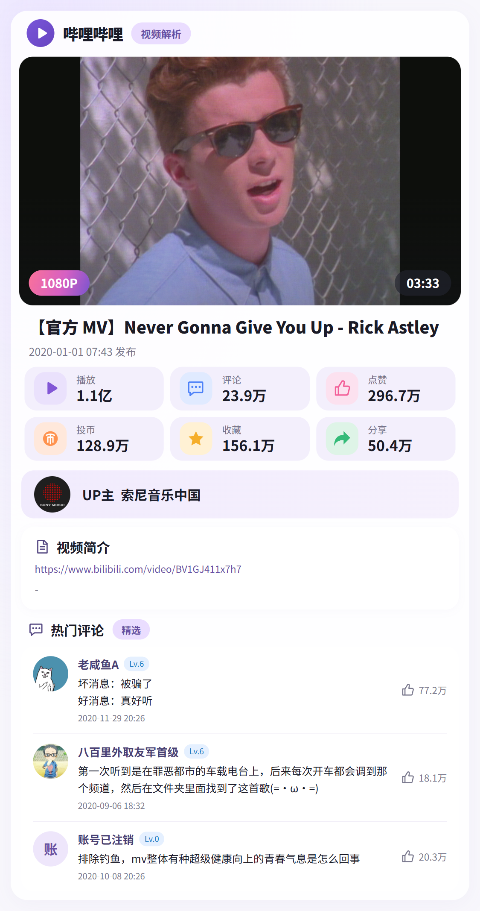
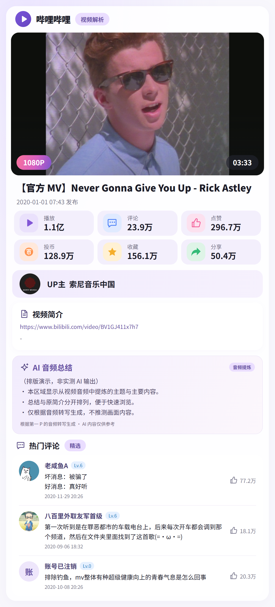

# B 站视频解析

AstrBot 插件。识别 B 站视频链接、BV 号及 QQ 分享卡片，生成视频信息卡，支持音频总结与视频发送。



## 功能

- 识别 BV 号、`bilibili.com/video/` 长链接、`b23.tv` / `bili2233.cn` 短链接、QQ B 站小程序和 JSON/XML 分享卡片、链接分享，以及合并转发中的视频；兼容长链接中的 av 号。
- 自动识别开关，默认关闭；始终可用 `@机器人 解析 地址` 或 `/bili 地址` 手动触发。
- 视频信息卡：16:9 封面、时长/分辨率标签、标题、发布时间、六项统计、UP 主、简介、热门评论。
- 六项数据为播放、评论、点赞、投币、收藏、分享。不含弹幕模块和关注按钮。
- 可选 AI 音频总结：提取第一 P 的真实音轨，语音转文字后交给 AI 总结，在卡片视频简介下方显示。
- 管理员私聊扫码登录，自动获取 Cookie；凭据加密保存在本机，支持查询登录状态和退出登录。
- 原生视频消息：可选清晰度、下载时长上限；超限只返回直链。上传结束后自动删除本地视频和合成中间文件。
- 同一会话内相同视频自动解析冷却、请求超时、短期数据缓存。评论失败仍显示视频，截图失败返回文字和视频地址。

## 安装

需要 Python 3.12+、AstrBot 4.29.1 或更新的 4.x 版本。正式版面向 QQ OneBot v11 适配器（`aiocqhttp`），包括 SnowLuma、NapCat 等协议端；主机、容器及混合部署方式均可配置。

1. 在 AstrBot 插件管理中通过仓库地址 `https://github.com/muyuawa/astrbot_plugin_bilicard` 安装，或从 [Releases](https://github.com/muyuawa/astrbot_plugin_bilicard/releases) 下载 `astrbot_plugin_bilicard-v1.0.0.zip` 后本地安装。也可将本目录放入 `AstrBot/data/plugins/astrbot_plugin_bilicard/`。
2. AstrBot 会根据 `requirements.txt` 安装 Python 依赖；若部署方式未自动安装，请在 **AstrBot 所用的 Python 环境**执行：

   ```sh
   python -m pip install -r data/plugins/astrbot_plugin_bilicard/requirements.txt
   python -m playwright install chromium
   ```

3. Linux / Docker 首次部署还需要浏览器系统依赖和中文字体。请在运行 AstrBot 的容器或主机内执行，例如 Debian / Ubuntu：

   ```sh
   python -m playwright install --with-deps chromium
   apt-get update
   apt-get install -y fonts-noto-cjk
   ```

   安装系统依赖的步骤需要相应系统权限。Docker 建议将其写入镜像，避免重建容器后丢失。

4. 如果已有 Chrome / Edge，可以直接重载插件。插件会优先尝试 Playwright Chromium，然后尝试本机 Chrome / Edge；也可在 `browser_path` 填写可执行文件完整路径。
5. 重载插件后私聊发送 `/bili 帮助`。

插件不会自行安装系统软件或后台下载浏览器。没有可用浏览器时仍可返回文字信息。

### uv 软件包部署

在执行过 `astrbot init` 的工作目录中，停止 AstrBot 后使用同一账号执行：

```sh
uv tool install astrbot --with-requirements data/plugins/astrbot_plugin_bilicard/requirements.txt
astrbot_python="$(uv tool dir)/astrbot/bin/python"
"$astrbot_python" -m playwright install --with-deps chromium
```

以上为 Linux 命令。Debian 11 下载 Chromium 出现不支持平台的报错时，可暂时固定仍提供相应浏览器下载配置的版本：

```sh
uv tool install astrbot --with-requirements data/plugins/astrbot_plugin_bilicard/requirements.txt --with "playwright==1.56.0"
astrbot_python="$(uv tool dir)/astrbot/bin/python"
"$astrbot_python" -m playwright install --with-deps chromium
```

如果原来安装 AstrBot 时指定了版本，以上命令保留原来的 `astrbot==版本号`。在 Windows PowerShell 中，浏览器安装使用：

```powershell
$astrbotPython = Join-Path (uv tool dir) "astrbot\Scripts\python.exe"
& $astrbotPython -m playwright install chromium
```

## 使用

```text
@机器人 解析 BV1GJ411x7h7
@机器人 解析 https://www.bilibili.com/video/BV1GJ411x7h7/
@机器人 解析 https://b23.tv/实际短链接
/bili BV1GJ411x7h7
```

开启 `auto_detect` 后，直接发送 BV 号、视频地址或 QQ 视频分享卡片即可。每条消息处理第一个识别到的视频。同一群聊 / 私聊的冷却时间独立计算，手动指令可随时重试。

插件通过消息监听器处理上述文本，不依赖模型调用。`@` 识别使用消息平台的真实提及消息段；手动输入“@机器人”这几个文字不会产生平台提及。

### QQ 小程序、卡片与合并转发

- 开启 `auto_detect` 后，直接发送或转发 B 站小程序/视频分享卡片即可。支持 `qqdocurl`、`jumpUrl` 等真实跳转字段，JSON 内的转义斜线、HTML 实体及编码后的链接会先还原。
- 关闭自动识别时，可以在同一条消息中附带卡片或合并转发，并 `@机器人 解析`。合并转发内部的命令或 @ 不会开启解析，也不会执行登录等操作。
- 支持普通链接分享、JSON 卡片、旧式 XML 卡片，以及 OneBot 的 CQ 字符串形式。卡片标题或封面里偶然出现的 BV 字样不作为视频地址。
- QQ OneBot 合并转发会通过当前协议端的 `get_forward_msg` 读取子消息；兼容 `content`、`message`、`messages` 结构以及直接携带的 Node/Nodes。SnowLuma 的 `id` 参数与此方式对应。插件只从转发中找链接，不向 AI 传递转发正文，也不将正文写入日志。
- 每次只解析第一个有效视频，后续音频总结和视频发送继续受各自开关控制。转发资源最多读取 3 个，单次最多遍历 200 个消息节点、16 层结构，单段文本最多 65,536 字符，总识别超时 10 秒，避免嵌套循环和连续刷屏。

卡片必须包含可读取的视频跳转地址，合并转发需要协议端支持读取接口。只有截图、失效转发或协议端未上报内容时无法识别，请复制视频链接或 BV 号再解析；本功能不做截图 OCR。无需新增 Python 依赖。

## 下载并发送视频

```text
/bili 下载 BV1GJ411x7h7
@机器人 下载 https://www.bilibili.com/video/BV1GJ411x7h7/
```

这两个指令直接获取视频，通过 AstrBot 的 **Video 视频组件**发送，可在支持的平台聊天窗口播放。不会改成文件附件发送。显式下载不依赖浏览器截图环境。

如需普通解析后也自动附带视频，在插件配置开启 `send_video`。默认关闭；开启后可配合 `auto_detect` 实现发链接即返回卡片和视频。

- `video_quality` 选择 360P、480P、720P、1080P、1080P60 或 4K，默认 720P。优先使用带音频的 MP4；需要更高画质时获取分离音视频并用 FFmpeg 合成。高画质能否获取取决于视频源、扫码账号和会员权限，拿不到目标画质时选择不高于设定的可用画质，并显示实际结果。
- `max_video_duration` 设置允许下载的最大秒数，默认 300 秒，0 表示不限。**超过上限不创建视频下载任务，只回复临时直链**；开启自动发送时也适用。时长恰好等于上限可以下载。当前下载第一个分 P，并按该分 P 的时长计算。
- 直链来自 B 站播放接口，存在时效，部分播放器需携带 B 站 Referer。优先提供包含声音的直链；接口只给出分离流时，会分别标注视频和音频地址。
- 文件大小超过 `max_video_size_mb`（默认 100 MiB）、网络/合成超时或上传失败时，清理当前任务文件并返回直链说明。
- 每次下载使用 `plugin_data/astrbot_plugin_bilicard/videos/` 下的独立临时目录，**等待视频上传接口完成后立即删除**。成功、下载失败、合成失败和发送失败的正常退出路径都会清理视频与中间文件，不保留视频缓存。

合并音视频需要系统 FFmpeg。Debian / Ubuntu 可执行：

```sh
sudo apt-get update
sudo apt-get install -y ffmpeg
```

其他系统可安装 FFmpeg 并加入 PATH，或在 `ffmpeg_path` 指定可执行文件路径。它是系统程序，`uv` 安装 Python 依赖不会安装它。

### 主机、容器与视频发送方式

通过 `video_send_mode` 选择视频的传递方式，所有方式都发送 **Video 视频消息**：

| 方式 | 适用部署 | 处理方式 |
| --- | --- | --- |
| `auto`（默认） | 同主机、同一容器、跨容器、已有回调配置 | 有 `callback_api_base` 时使用 HTTP 回调，否则先使用本地文件；QQ OneBot 明确返回文件不可读时切换 Base64 重试一次 |
| `local` | AstrBot 和协议端都在主机、同一容器，或共享相同路径 | 以 `file:///...` 传递本地视频；协议端需有读取权限 |
| `base64` | AstrBot 在主机、SnowLuma/NapCat 在 Docker，或不同机器 | 通过 OneBot 连接传递视频内容，不依赖共享文件路径；视频最大 64 MiB |
| `callback` | 协议端可访问 AstrBot 文件服务 | 将本地文件注册为临时 HTTP 地址，再发送视频消息；需设置 `callback_api_base` |

**AstrBot 在主机、SnowLuma 在 Docker：**先将发送方式设为 `base64` 并重载插件。视频内容通过现有 OneBot 连接传入容器，不需要挂载主机的插件数据目录。超过 64 MiB 的视频可降低清晰度，或选择 `callback`；已共享目录的部署也可选择 `local`。

使用 `auto` 时，当本地视频发送返回 `EACCES`（无读取权限）、`ENOENT`（路径不存在）等明确文件访问错误，会使用同一份已下载视频自动切换 Base64 重试一次。文件在重试结束后才清理，不会重复下载。连接超时、账号权限或其他不明确的上传失败不会触发重试；强制 `local`、`base64`、`callback` 模式保持各自方式。

本地模式要求两个进程能看到**相同路径**且有读取权限；仅处于同一物理主机并不表示 Docker 能读取主机路径。HTTP 回调地址须填写**容器能访问的主机地址**，例如 `http://主机地址:6185`，容器里的 `127.0.0.1` 指向容器自己。绑定目录时无需向协议端提供登录凭据目录。

平台自身的视频大小、时长及发送权限限制仍会生效；不支持视频时提示失败并提供直链。无论采用哪种方式，均等待发送接口返回后清理当前任务的本地媒体文件。

### 视频发送诊断

下载、消息准备、上传和清理会记录 `BiliCard[诊断编号]`：

- `video_download_start`：已开始下载。
- `video_ready`：本地视频已就绪，包含文件大小、位置和耗时。
- `video_send_start mode=...`：准备使用指定方式上传。
- `video_send_fallback from=file_uri to=base64`：自动模式遇到明确文件访问失败，切换为跨容器传输。
- `video_send_returned`：平台发送接口已返回；最终播放效果仍由协议端与 QQ 决定。
- `video_failed stage=...`：记录失败阶段、异常类型和协议错误码；Cookie、Base64 内容与临时 URL 会脱敏。
- `video_job_finished`：任务结束及本地文件是否已清理。

下载提示、直链和错误详情强制保持文字，便于复制，避免全局文转图把真实失败提示隐藏在图片中。

## AI 音频总结

默认关闭。开启后普通解析会执行「提取音轨 → STT 语音转写 → AI 总结 → 生成卡片」，总结显示在 **视频简介下方、热门评论上方**，沿用原卡片的淡紫色圆角样式。生成期间会先回复一条文字提示；关闭时不下载音轨、不调用 AI。

1. 在运行 AstrBot 的环境中安装 FFmpeg，或设置 `ffmpeg_path`。安装方式同上。
2. 在 AstrBot 中配置可用的 **语音识别（STT）服务**和 **聊天模型（LLM）**。
3. 插件配置中开启 `audio_summary`，选择 `summary_stt_provider_id` 与 `summary_llm_provider_id`。也可留空，分别使用当前会话所选的 STT 与聊天模型。
4. 保存并重载，照常发送 `/bili 地址` 或 `@机器人 解析 地址`。无需额外的总结指令，也不要求开启 `send_video`。

优先下载较小的 DASH 音轨；只有接口提供合流媒体时，才从低画质视频中提取。音频转为 16 kHz、单声道 PCM WAV 供 STT 读取。沿用 `max_video_duration`：默认超过 300 秒跳过总结，0 不限时长；下载输入沿用 `max_video_size_mb`，提取后的 WAV 上限 20 MiB，转写上限 60,000 字符。`summary_timeout` 默认 180 秒，包含整个总结流程。STT 服务本身的时长、格式或上传限制仍会生效。

只总结第一 P **音频中可识别的内容**，不分析画面，不以视频简介替代转写。无有效语音、未配置服务或处理失败时，在总结区域显示说明，原视频卡片继续发送。超过视频下载上限且请求发送视频时，继续沿用只返回直链的行为；`/bili 下载` 不生成卡片或总结。

模型调用不传聊天历史、人格和工具。音频会交给所选 STT 服务、转写会交给所选聊天模型，可能按提供商规则产生费用；插件不另存转写文本。临时音轨和 WAV 在识别完成、异常或取消时清理，AI 总结后只保留正常的卡片截图。主机与容器部署均在 **AstrBot 自己所在环境**中完成音频处理，不需要 QQ 协议端读取音频文件。



## 扫码登录获取 Cookie

先将自己的账号设置为 **AstrBot 管理员**，然后私聊机器人：

```text
/bili 登录
/bili 登录状态
/bili 退出登录
```

`/bili 登录` 发送二维码。使用哔哩哔哩 App 扫码并确认，插件每 3 秒检查一次状态，成功后自动保存 Cookie，无需复制浏览器 Cookie。二维码约 3 分钟有效；再次发送登录指令会取消上一个等待中的二维码。

群聊中和非管理员账号均不能使用登录管理功能。**该账号供本 AstrBot 实例的所有会话解析共用**，并非每位群成员独立登录。只有读取视频/评论和验证登录状态的功能，不进行关注、点赞、投币或投稿。

Cookie 只发送给 `api.bilibili.com`。扫码请求直接访问 B 站官方 `passport.bilibili.com`，二维码兼容官方 `passport.bilibili.com` / `account.bilibili.com` 页面；封面和头像来自 B 站 CDN，不携带 Cookie。卡片截图在本地完成。

凭据通过 Fernet 加密，存放于 AstrBot 数据目录下：

```text
plugin_data/astrbot_plugin_bilicard/account.enc
plugin_data/astrbot_plugin_bilicard/account.key
```

请保护整个插件数据目录。加密文件和本地密钥放在同一主机，无法防止能读取这两个文件的人解密。日志、回复消息和卡片不展示 Cookie。退出登录会删除本插件的这两个文件并清除内存凭据；如需撤销 B 站服务器上的登录会话，请在 B 站账号安全设置中管理登录设备。

登录失效时重新扫码即可。本版本不自动刷新长期登录凭据。

## 配置

在 AstrBot 插件配置中修改，保存后重载插件。

| 配置 | 默认值 | 说明 |
| --- | --- | --- |
| `auto_detect` | `false` | 直接识别链接、BV 号及 QQ 分享卡片 |
| `comments_count` | `3` | 热门评论数量 0–5；0 隐藏评论模块 |
| `cooldown_seconds` | `60` | 同一会话相同视频自动解析的冷却时间，0–600 秒 |
| `request_timeout` | `12` | 单次网络请求超时，5–30 秒 |
| `audio_summary` | `false` | 普通解析时生成 AI 音频总结，显示在简介下方 |
| `summary_stt_provider_id` | 空 | 所选 STT 服务；空为当前会话服务 |
| `summary_llm_provider_id` | 空 | 所选聊天模型；空为当前会话模型 |
| `summary_timeout` | `180` | 下载、提取、识别与总结总超时，30–1800 秒 |
| `browser_path` | 空 | 本机或容器内浏览器可执行文件路径 |
| `send_video` | `false` | 普通解析后自动下载并发送视频；显式下载指令始终可用 |
| `video_send_mode` | `auto` | auto / local / base64 / callback；跨容器可选 base64（最大 64 MiB） |
| `video_quality` | `720P` | 360P / 480P / 720P / 1080P / 1080P60 / 4K |
| `max_video_duration` | `300` | 视频下载及音频总结时长上限（秒）；0 不限，视频发送超限只给直链 |
| `max_video_size_mb` | `100` | 视频大小上限（MiB），1–500 |
| `video_timeout` | `300` | 下载与合成总超时（秒），30–1800 |
| `ffmpeg_path` | 空 | 视频合并和音频总结使用；留空从 PATH 查找 FFmpeg |

分辨率标签取自视频源尺寸。不会因标题写着“4K/60帧”就伪造对应画质，也不会额外获取视频流来推断帧率。封面优先铺满 16:9 容器，源图自带的黑边会保留。

标题最多 3 行，简介最多 7 行，每条评论最多 4 行，避免超长文本生成无法在聊天窗口阅读的图片。原视频地址显示在简介区；PNG 内文字和图标不具备可点击交互。

## 常见问题

- **评论不可用**：可先扫码登录。B 站的访问限制、视频权限或关闭评论仍可能导致读取失败，此时卡片显示说明，不影响主体信息。
- **变成文字回复**：检查 Playwright 浏览器安装和 `browser_path`，Linux 还需检查浏览器系统依赖与中文字体。
- **普通链接没有自动回复**：默认关闭自动识别；在插件配置启用 `auto_detect`，或使用手动解析指令。
- **@ 后没有响应**：检查平台提及是否指向机器人本身，以及 AstrBot 的插件启用范围、消息白名单和适配器消息接收设置。
- **封面或头像显示占位**：CDN 获取失败、媒体过大或不是受支持的图片格式时使用占位，其他信息照常显示。
- **卡片缓存**：视频和评论短期缓存约 2 分钟；截图超过 1 小时会在下次生成时清理。刷新登录状态会清空数据缓存。

## 本地预览与必要检查

不启动 AstrBot 也可生成一张真实视频卡片：

```sh
python tools/preview.py BV1GJ411x7h7 --output preview-output/bilicard.png
```

同时输出内嵌媒体的 HTML，便于调整模板。独立预览默认匿名访问，使用的 Cookie 与机器人数据目录隔离。

在插件目录的父目录运行现有必要检查：

```sh
python -m unittest discover -s astrbot_plugin_bilicard/tests -q
```

事件边界测试用简化 SDK 类型隔离 AstrBot 环境；正式安装后仍需在实际适配器中验证消息发送与一次人工扫码确认。

接口依据：[AstrBot 消息事件](https://docs.astrbot.app/dev/star/guides/listen-message-event.html)、[AstrBot 消息发送](https://docs.astrbot.app/dev/star/guides/send-message.html)、[提供商接口](https://github.com/AstrBotDevs/AstrBot/blob/v4.29.1/astrbot/core/provider/provider.py)、[插件配置](https://docs.astrbot.app/dev/star/guides/plugin-config.html)及 B 站官方接口的实际响应。B 站 Web 接口的可用性和返回字段可能变化。

## 许可证

本插件代码采用 [MIT License](LICENSE)。预览中的视频封面、头像及相关内容仅用于演示，权利归对应创作者或平台所有；预览视频为 [BV1GJ411x7h7](https://www.bilibili.com/video/BV1GJ411x7h7)。本插件与哔哩哔哩、腾讯无隶属关系。
